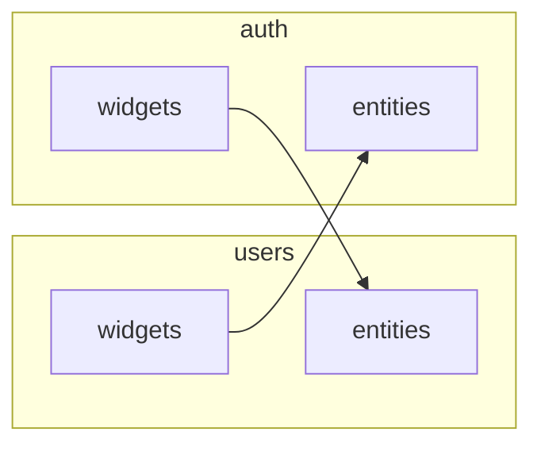
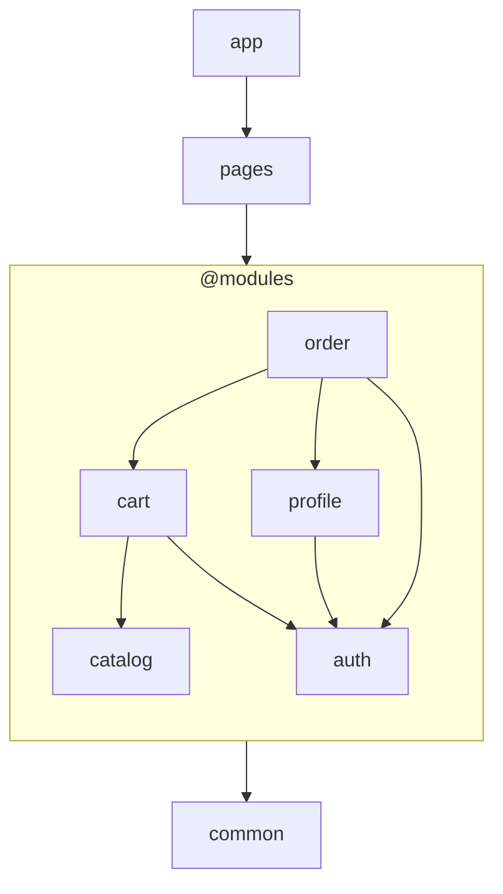

# Модули и точки входа

Модуль в WELD — это способ организовать доменный и прикладной код в пределах одной функциональной
области.

Модули позволяют собирать код одного домена в одном месте, даже если он относится к разным слоям
приложения.

Например, модуль `users` может содержать и список пользователей, и компонент аватара. Оба компонента
относятся к одному домену, хотя могут находиться на разных слоях приложения.

При этом модуль не обязательно должен предоставлять всё своё содержимое через одну точку входа.
Разным слоям могут требоваться разные интерфейсы одного модуля, поэтому WELD допускает модули с
одной или несколькими точками входа.

## Когда одному модулю нужны разные точки входа

Рассмотрим два модуля: `auth`, отвечающий за текущую сессию пользователя, и `users`, содержащий
компоненты для работы с пользователями.

Модуль `auth` предоставляет виджет управления текущей сессией и хук для получения данных текущего
пользователя. Модуль `users` содержит список пользователей и компонент аватара.

```text
auth/
  widgets/
    ProfileMenu
  entities/
    useCurrentUser

users/
  widgets/
    UsersList
  entities/
    UserAvatar
```

Компонент `ProfileMenu` должен отображать аватар текущего пользователя, поэтому ему нужен
`UserAvatar` из модуля `users`. В свою очередь, `UsersList` может использовать `useCurrentUser`,
чтобы выделять текущего пользователя в списке.

Таким образом, `auth` зависит от части `users`, а `users` — от части `auth`.

Если рассматривать модули целиком, возникает цикл зависимостей. Но на уровне слоёв зависимости
направлены в одну сторону: `widgets` могут использовать `entities`, но не наоборот.

## Модули и слои — разные измерения архитектуры

Модули и слои решают разные задачи.

Модуль объединяет код одной функциональной области. Слои задают порядок зависимостей между частями
приложения: код верхнего слоя может использовать код нижнего, но не наоборот.

Поэтому зависимости между модулями не обязательно должны образовывать ациклический граф. Важно,
чтобы зависимости между их точками входа соблюдали установленный порядок слоёв.

В предыдущем примере `ProfileMenu` из `auth/widgets` использует `UserAvatar` из `users/entities`, а
`UsersList` из `users/widgets` — `useCurrentUser` из `auth/entities`. Обе зависимости направлены от
`widgets` к `entities`. Цикл возникает только при рассмотрении модулей как неделимых единиц.

Такое разделение позволяет одновременно организовывать код по доменам и контролировать зависимости
между слоями, не требуя, чтобы каждый модуль был полностью независим от остальных.

## Как модули встраиваются в архитектуру приложения

Состав слоёв — часть архитектуры конкретного проекта. WELD не навязывает универсальный набор: проект
сам определяет, какие слои ему нужны и в каком порядке они располагаются.

Для описания архитектуры используются два списка: `layers` задаёт слои приложения, а `moduleLayers`
— слои, которые могут использоваться внутри модулей.

Например:

```ts
layers: ['common', '@modules', 'pages', 'app'],
moduleLayers: ['entities', 'widgets'],
```

Эта конфигурация задаёт следующий порядок слоёв:

```text
common
entities
widgets
pages
app
```

Маркер `@modules` обозначает место, в котором располагаются слои модулей. Поэтому `entities` и
`widgets` становятся частью общей архитектуры приложения, а не отдельной системой слоёв,
существующей независимо от неё.

Такой подход позволяет сочетать доменную организацию кода с единым порядком слоёв. При этом проект
может выбрать другой набор слоёв или обойтись без некоторых из них — конфигурация отражает
архитектуру проекта, а не универсальный шаблон.

## Как структура каталогов определяет точки входа

Модуль может предоставлять одну или несколько точек входа. Это зависит от того, как организован его
код и какие слои ему нужны.

**Модуль с одной точкой входа** не разделяет код на несколько слоёв:

```text
modules/
  calculations/
    index.ts
```

Корневой `index.ts` выступает единственной точкой входа модуля. Внешний код обращается к его
содержимому через этот файл.

**Модуль с несколькими точками входа** разделяет код по слоям:

```text
modules/
  users/
    entities/
      index.ts
    widgets/
      index.ts
```

Здесь `entities` и `widgets` предоставляют отдельные точки входа. Другие модули могут обращаться к
соответствующему слою, не импортируя содержимое соседних слоёв через общий корневой интерфейс.

WELD определяет структуру точек входа по каталогам модуля. Если каталог непосредственно внутри
модуля соответствует одному из слоёв, объявленных в `moduleLayers`, его содержимое относится к этому
слою. Поэтому добавление или изменение каталогов может влиять на архитектурную интерпретацию модуля.

Если модуль использует несколько точек входа, корневой `index.ts` не нужен: точками входа становятся
каталоги и файлы непосредственно внутри модуля. Для структуры, не соответствующей объявленным слоям,
WELD предусматривает отдельное правило, которое рассмотрим вместе с остальными правилами организации
модулей.

## Правила организации модулей

Из модели модулей и точек входа следуют четыре правила.

1. **Модуль с одной точкой входа имеет корневой баррель.**

    Если модуль предоставляет одну точку входа, его корневой `index.ts` определяет публичный API.
    Другие модули не должны обращаться к внутренним файлам такого модуля в обход барреля.

2. **Модуль с несколькими точками входа не имеет корневого барреля.**

    В этом случае точками входа становятся каталоги и файлы непосредственно внутри модуля. Каждый из
    них предоставляет отдельный интерфейс для потребителей.

3. **Каталог слоя определяет принадлежность к слою.**

    Если каталог непосредственно внутри модуля соответствует одному из слоёв, объявленных в
    `moduleLayers`, весь код внутри него относится к этому слою.

4. **Нестандартные точки входа располагаются перед объявленными слоями модулей.**

    Если точка входа не соответствует ни одному слою из `moduleLayers`, WELD рассматривает её как
    пользовательскую — `@custom`. Такие точки входа располагаются перед объявленными слоями модулей
    в общем порядке зависимостей.

    Например, при `moduleLayers: ['entities', 'widgets']` порядок будет следующим:

    ```text
    common
    @custom
    entities
    widgets
    pages
    app
    ```

Эти правила позволяют WELD определять архитектурные границы по структуре каталогов и проверять
направление зависимостей между ними. При этом доменная организация остаётся гибкой: модуль может
предоставлять один общий интерфейс или несколько точек входа, соответствующих разным слоям.

## sd ---------------- dd

# Модули и точки входа

Модули — удобный способ организовать доменный и прикладной код.

Во многих случаях удобно, что бы у модуля было несколько точек входа

### Пример

Виджет _списка пользователей_ очевидно относится к модулю `users`, как и _аватар пользователя_.

Виджет _текущего сессии_ лежит в `auth`, как и _хук получения данных текущей сессии_.

Но в виджете _текущей сессии_ требуется отобразить _аватар текущего пользователя_, а в списке
пользователей требуется выделить текущего пользователя, для этого нужен _хук получения данных
текущей сессии_.

```
auth/widgets/ProfileMenu: Виджет управления текущей сессии
auth/entities/useCurrentUser: Данные текущей сессии
users/widgets/UsersList: Список пользователей
users/entities/UserAvatar: Аватар пользователя
```



Т.е. формально между модулями циклическая зависимость, а по факту ее нет, так как это направление
зависимости слоев не нарушается

### Слои

Но в некоторых случаях отдельные слои модулю не нужны: например это вычислительный модуль

Таким образом у модуля может быть одна или несколько точек входа

Это можно организовать следующим образом:

Модуль с одной точкой входа

```txt
modules
    - calculations
        - index.ts
```

Модуль с несколькими точками входа

```txt
modules
    - users
        - entities
            - index.ts
        - widgets
            - index.ts
```

### Слои приложения

Тогда имеет смысл описывать раздельно список слоев приложения и список слоев модулей:

```ts
layers: ['common', '@modules', 'pages', 'app'];
moduleLayers: ['entities', 'features', 'widgets'];
```

`@modules` отмечает в списке слоёв место, где располагаются слои модулей.

Пример структуры приложения, подходящей под указанную конфигурацию:

<div align="center">



что соответствует конфигурации <br/>`layers: ['common', '@modules', 'pages', 'app']`

</div>

`pages` и `app` могут импортировать публичные точки входа любого модуля, а модули используют доменно
независимый код из `common`.

## Конфигурация

Список и порядок слоев задается явной конфигурацией проекта:

```ts
layers: ['common', '@modules', 'pages', 'app'],
moduleLayers: ['entities', 'widgets'],
```

что соответствует порядку слоев 'common', 'entities', 'widgets', 'pages', 'app'

## Какую проблему решает

Модуль собирает код домена в одном месте, а не раскладывает его по директориям всего проекта.

## Правила

1. **Модуль с единой точкой входа**

    должен иметь в корне баррель, обращаться другим модулям к другим его точкам входа запрещено (см
    концепция API директории)

2. **Модуль с несколькими точками входа**

    не имеет барреля в корне, и все директории и файлы в корне модуля являются точками входа

3. **Соответствие точек входа и слоев**

    Директория непосредствевнно в модуле, одноименная объявленному слою модуля относит весь код в
    ней к этому слою

4. **Необъявленные точки входа**

    Все остальные точки входа считаются произвольными (помечаются как `@custom`) и в списке слоев
    идут перед объявленными слоями модулей

    что соответствует порядку слоев 'common', '@custom', 'entities', 'widgets', 'pages', 'app'
