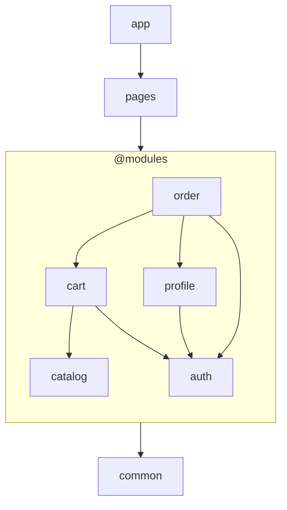
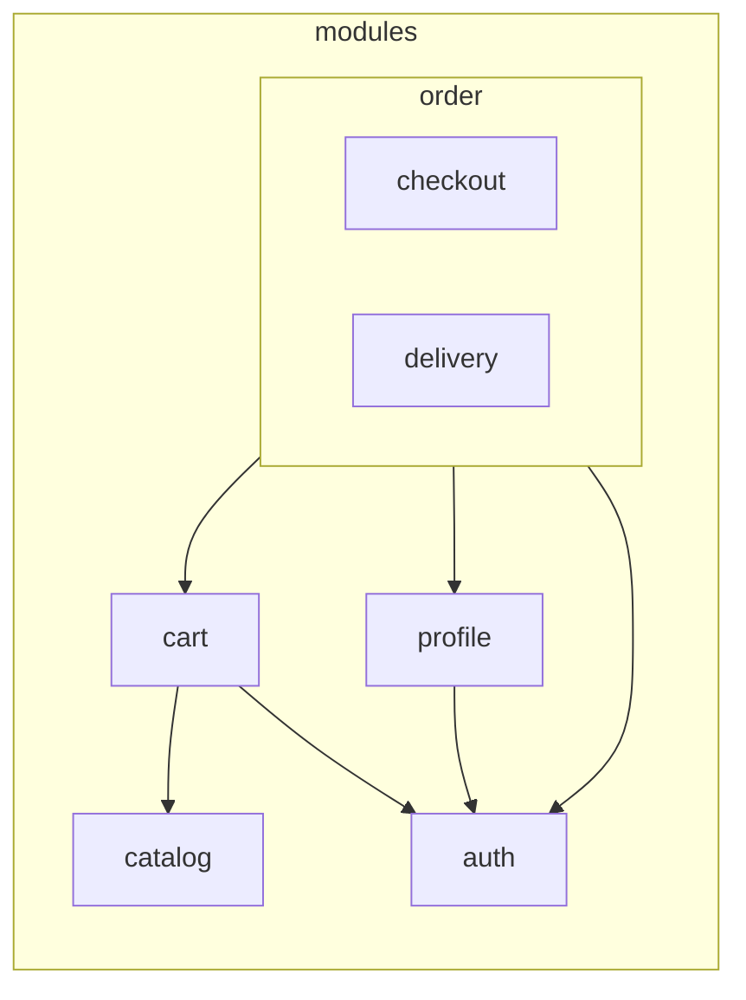

# Модули и фрактальность

Модули — удобный способ организовать доменный и прикладной код.

что соответствует конфигурации  `layers: ['common', '@modules', 'pages', 'app']`

`@modules` отмечает в списке слоёв место, где располагаются слои модулей. На схеме это место
показано одним блоком с модулями.

`pages` и `app` могут импортировать публичные точки входа любого модуля, а модули используют доменно
независимый код из `common`.

Когда модуль разрастается, его можно разделить на вложенные модули. Они остаются частью
родительского модуля и подчиняются тем же правилам, что и модули верхнего уровня.

Вложенность не создаёт отдельной архитектурной модели: корневые и вложенные модули подчиняются одним
правилам. Это свойство называется фрактальностью.

## Какую проблему решает

Модуль собирает код домена в одном месте, а не раскладывает его по директориям всего проекта.

Вложенные модули позволяют разделить ответственность внутри разросшегося модуля, не превращая его
внутренние части в модули верхнего уровня. Дочерний модуль остаётся в ветке родительского модуля и
недоступен модулям вне этой ветки. Поэтому его выделение не расширяет публичный API родительского
модуля.

## Правила

1. **Вложенные модули находятся в контейнере модуля.**

    Модуль может содержать вложенные модули в своём каталоге `modules/`. Этот каталог — только
    контейнер: у него нет собственных слоёв, публичного API и барреля. Имя контейнера задаёт проект;
    в примерах используется значение по умолчанию — `modules`.

2. **На каждом уровне повторяются только правила модуля.**

    Вложенный модуль получает тот же набор `moduleLayers`, подчиняется тем же правилам видимости и
    публикует API так же, как модуль верхнего уровня. `common`, `pages` и `app` существуют в проекте
    в единственном экземпляре и внутри модулей не повторяются.

3. **Видимость определяется положением модуля в дереве.**

    От модуля проводят путь к корню дерева. Доступны публичные точки входа модулей на этом пути и
    модулей, расположенных непосредственно внутри каждого из них. Более глубокие модули соседних
    веток недоступны. Порядок слоёв остаётся дополнительным ограничением: видимый модуль нельзя
    импортировать, если его точка входа находится в неразрешённом слое.

4. **Вложенный модуль публикует API сам.**

    Его публичные точки входа доступны без обязательного реэкспорта через модуль, в котором он
    находится. Слои композиции `pages` и `app` могут импортировать публичные точки входа модулей на
    любой глубине. Видимый модуль не открывает свои внутренние файлы: даже разрешённый потребитель
    использует только опубликованные точки входа.
