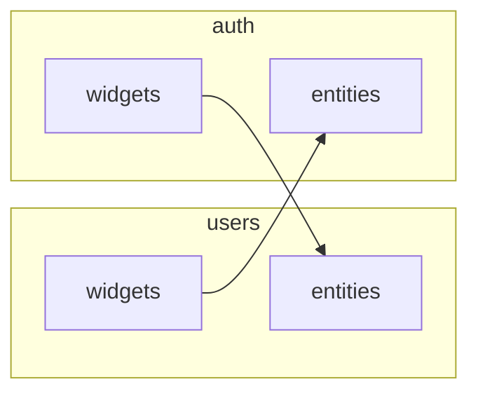
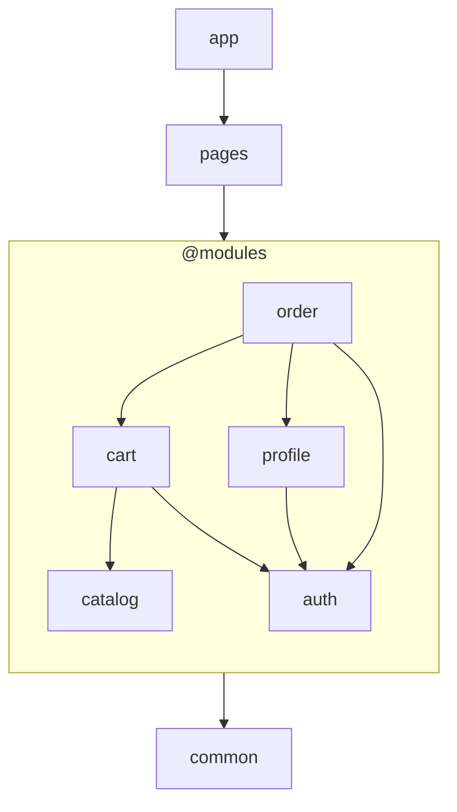

# Модули и точки входа

Модули — удобный способ организовать доменный и прикладной код.

Во многих случаях удобно, что бы у модуля было несколько точек входа

### Пример

Виджет _списка пользователей_ очевидно относится к модулю `users`, как и _аватар пользователя_.

Виджет _текущего сессии_ лежит в `auth`, как и _хук получения данных текущей сессии_.

Но в виджете _текущей сессии_ требуется отобразить _аватар текущего пользователя_, а в списке
пользователей требуется выделить текущего пользователя, для этого нужен _хук получения данных
текущей сессии_.

```
auth/widgets/ProfileMenu: Виджет управления текущей сессии
auth/entities/useCurrentUser: Данные текущей сессии
users/widgets/UsersList: Список пользователей
users/entities/UserAvatar: Аватар пользователя
```



Т.е. формально между модулями циклическая зависимость, а по факту ее нет, так как это направление
зависимости слоев не нарушается

### Слои

Но в некоторых случаях отдельные слои модулю не нужны: например это вычислительный модуль

Таким образом у модуля может быть одна или несколько точек входа

Это можно организовать следующим образом:

Модуль с одной точкой входа

```txt
modules
    - calculations
        - index.ts
```

Модуль с несколькими точками входа

```txt
modules
    - users
        - entities
            - index.ts
        - widgets
            - index.ts
```

### Слои приложения

Тогда имеет смысл описывать раздельно список слоев приложения и список слоев модулей:

```ts
layers: ['common', '@modules', 'pages', 'app'];
moduleLayers: ['entities', 'features', 'widgets'];
```

`@modules` отмечает в списке слоёв место, где располагаются слои модулей.

Пример структуры приложения, подходящей под указанную конфигурацию:

<div align="center">



что соответствует конфигурации <br/>`layers: ['common', '@modules', 'pages', 'app']`

</div>

`pages` и `app` могут импортировать публичные точки входа любого модуля, а модули используют доменно
независимый код из `common`.

## Конфигурация

    Список и порядок слоев задается явной конфигурацией проекта:

```ts
layers: ['common', '@modules', 'pages', 'app'],
moduleLayers: ['entities', 'widgets'],
```

    что соответствует порядку слоев 'common', 'entities', 'widgets', 'pages', 'app'

## Какую проблему решает

Модуль собирает код домена в одном месте, а не раскладывает его по директориям всего проекта.

## Правила

1. **Модуль с единой точкой входа**

    должен иметь в корне баррель, обращаться другим модулям к другим его точкам входа запрещено (см
    концепция API директории)

2. **Модуль с несколькими точками входа**

    не имеет барреля в корне, и все директории и файлы в корне модуля являются точками входа

3. **Соответствие точек входа и слоев**

    Директория непосредствевнно в модуле, одноименная объявленному слою модуля относит весь код в
    ней к этому слою

4. **Необъявленные точки входа**

    Все остальные точки входа считаются произвольными (помечаются как `@custom`) и в списке слоев
    идут перед объявленными слоями модулей

    что соответствует порядку слоев 'common', '@custom', 'entities', 'widgets', 'pages', 'app'
