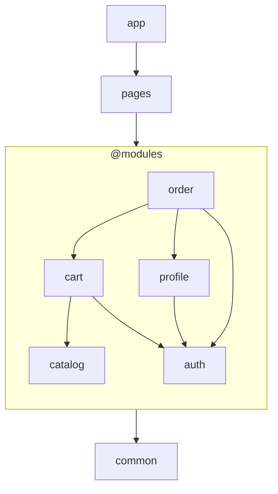
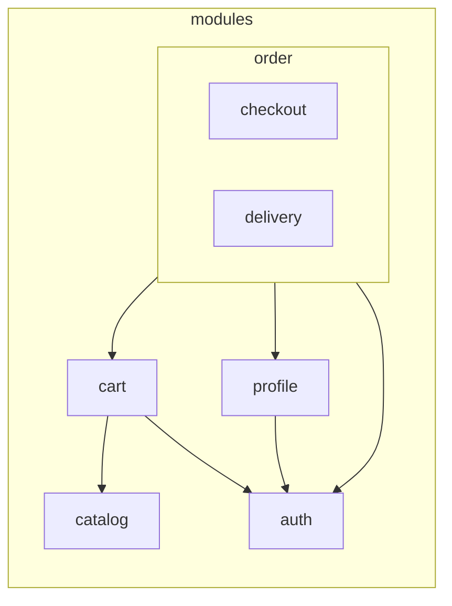

# Модули и фрактальность

Модули — удобный способ организовать доменный и прикладной код.

что соответствует конфигурации  `layers: ['common', '@modules', 'pages', 'app']`

`@modules` отмечает в списке слоёв место, где располагаются слои модулей. На схеме это место
показано одним блоком с модулями.

`pages` и `app` могут импортировать публичные точки входа любого модуля, а модули используют доменно
независимый код из `common`.

Когда модуль разрастается, его можно разделить на вложенные модули. Они остаются частью
родительского модуля и подчиняются тем же правилам, что и модули верхнего уровня.

Вложенность не создаёт отдельной архитектурной модели: корневые и вложенные модули подчиняются одним
правилам. Это свойство называется фрактальностью.

## Какую проблему решает

Модуль собирает код домена в одном месте, а не раскладывает его по директориям всего проекта.

Вложенные модули позволяют разделить ответственность внутри разросшегося модуля, не превращая его
внутренние части в модули верхнего уровня. Дочерний модуль остаётся в ветке родительского модуля и
недоступен модулям вне этой ветки. Поэтому его выделение не расширяет публичный API родительского
модуля.
