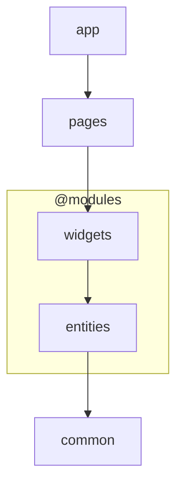
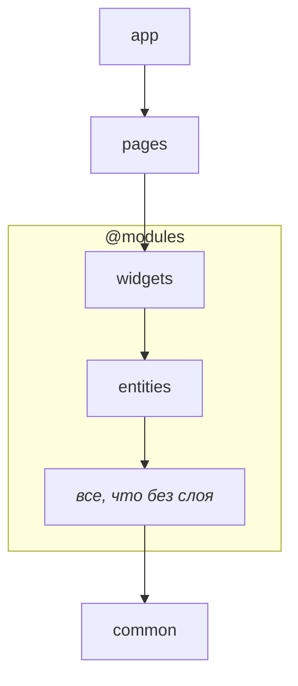

# Модули

Модуль — это самостоятельная, логически связанная часть программы, отвечающая за конкретную
функциональную область.

Модули в WELD позволяют собирать код одного домена в одном месте, даже если он относится к разным
слоям приложения.

Например, модуль `users` может содержать и список пользователей, и компонент аватара. Оба компонента
относятся к одному домену, хотя могут находиться на разных слоях приложения.

При этом модуль не обязательно должен предоставлять всё своё содержимое через одну точку входа.
Несколько точек входа позволяют сохранить единый модуль как функциональную область, при этом
предоставляя интерфейсы, которые относятся к разным слоям.

:::warning Модули и слои — разные оси архитектуры

**Модуль** объединяет код одной функциональной области

**Слои** задают порядок зависимостей между частями приложения

:::

## Какую проблему решает

Разделение по этим осям позволяет одновременно держать весь код домена рядом и контролировать
зависимости между слоями, не требуя, чтобы каждый модуль был полностью независим от остальных.

Рассмотрим два модуля: `auth`, отвечающий за текущую сессию пользователя, и `users`, содержащий
компоненты для работы с пользователями.

Модуль `auth` предоставляет виджет управления текущей сессией и хук для получения данных текущего
пользователя. Модуль `users` содержит список пользователей и компонент аватара.

```text
auth/
  widgets/
    ProfileMenu
  entities/
    useCurrentUser

users/
  widgets/
    UsersList
  entities/
    UserAvatar
```

Компонент `ProfileMenu` должен отображать аватар текущего пользователя, поэтому ему нужен
`UserAvatar` из модуля `users`. В свою очередь, `UsersList` может использовать `useCurrentUser`,
чтобы выделять текущего пользователя в списке.

Таким образом, `auth` зависит от части `users`, а `users` — от части `auth`.

Если рассматривать только зависимости между модулями, возникает цикл зависимостей. Однако на уровне
слоёв зависимости направлены в одну сторону: `widgets` могут использовать `entities`, но не
наоборот.

## Слои модулей и слои приложения

Состав слоёв — часть архитектуры конкретного проекта. WELD не навязывает универсальный набор: проект
сам определяет, какие слои ему нужны и в каком порядке они располагаются.

Для описания архитектуры используются два списка:

- `layers` задает слои приложения
- `moduleLayers` задает слои модулей

**Например,** конфигурация:

`layers: common, @modules, pages, app` <br/>`moduleLayers: entities, widgets`

задаёт следующий порядок слоёв:

<div align="center">



</div>

Маркер `@modules` обозначает место, в котором располагаются слои модулей. Поэтому `entities` и
`widgets` становятся частью общей архитектуры приложения, а не отдельной системой слоёв,
существующей независимо от неё.

Такой подход позволяет сочетать доменную организацию кода с единым порядком слоёв.

## Модуль с одной точкой входа

Модуль с одной точкой входа имеет корневой баррель, и другие модули имеют права обращаться к нему
только через этот баррель

Пример:

```text
modules/
  calculations/
    index.ts
```

## Модуль с несколькими точками входа

У такого модуля нет корневого барреля: точками входа служат все его непосредственные файлы и
каталоги.

Например, модуль с такой структурой

```text
modules/
  users/
    routes.ts
    entities/
      index.ts
    widgets/
      index.ts
    utils/
      index.ts
```

предоставляет 4 точки входа: `entities`, `widgets`, `utils` и `routes.ts`. Другие модули могут
обращаться к соответствующей точке входа, не импортируя лишнего.

Вложенные директории и файлы не могут быть точками входа в модуль. Так, файл
`users/widgets/nice-widget.ts`, не является корректной точкой входа.

## Соответствие точек входа и слоев

Слой определяется из имени точки входа: если имя соответствует слою - значит она относится к этому
слою.

> При `moduleLayers: entities, widgets` в примере выше, директория `users/widgets` и все ее
> содержимое относится к слою `widgets`, а директория `users/entities` - к слою `entities`.

Все директории и файлы, не соответствующие объявленным слоям, относятся к уровню ниже всех слоёв
модуля.

<div align="center">



</div>

## Правила

1. **Модуль с центральной точкой входа имеет корневой баррель**

    Если модуль предоставляет центральную точку входа, он должен иметь корневой `index.ts`, который
    и определяет публичный API. Внешние модули не должны обращаться к внутренним файлам такого
    модуля в обход барреля.

2. **Модуль с несколькими точками входа не имеет корневого барреля**

    В этом случае точками входа становятся каталоги и файлы непосредственно внутри модуля. Каждый из
    них предоставляет отдельный интерфейс для потребителей.

3. **Имя точки входа определяет принадлежность к слою**

    Если имя точки входа соответствует одному из слоёв, объявленных в `moduleLayers`, весь код
    внутри него относится к этому слою.

4. **Файлы без слоя - ниже всех слоев модуля**

    Все директории и файлы, не соответствующие объявленным слоям, относятся к уровню ниже всех слоёв
    модуля.

5. **Модуль с центральной точкой входа ниже всех слоев модуля**

    Такой модуль не может импортировать другие модули, но любой слой внешних модулей может его
    импортировать.

Эти правила позволяют WELD определять архитектурные границы по структуре каталогов и проверять
направление зависимостей между ними. При этом доменная организация остаётся гибкой: модуль может
предоставлять один общий интерфейс или несколько точек входа, соответствующих разным слоям.
