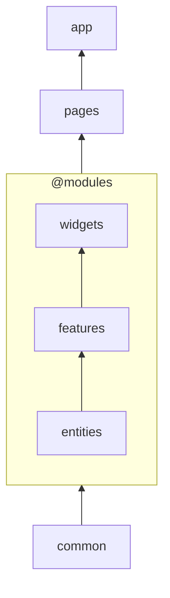

# Схема слоёв

Слои и порядок между ними — часть архитектуры конкретного проекта: состав, количество и границы
слоёв [определяет сам проект](../core-concepts/layers.md). Общей остаётся форма: слои выстраиваются
в один порядок от самого стабильного к самому изменчивому, и слой может импортировать только то, что
стоит [ниже него](../core-concepts/direction.md).

Схема слоёв — две настройки в [`settings.weld`](../rules/settings.md):

- `layers` — слои проекта;
- `moduleLayers` — слои внутри модуля.

```js
export default [
    {
        settings: {
            weld: {
                layers: ['common', '@modules', 'pages', 'app'],
                moduleLayers: ['entities', 'features', 'widgets'],
            },
        },
    },
];
```

Импорт разрешён только вниз: `app` может импортировать `pages`, слои модулей и `common`; `pages` —
слои модулей и `common`; `common` не может импортировать никого.

<div align="center">



</div>

## `layers` — слои проекта

`layers` — один упорядоченный список на весь проект. Обычные имена в нём — слои проекта: директория
с таким именем относится к этому слою. Кроме них в списке есть две спец-позиции:

- `@modules` — место, куда встают слои модулей из `moduleLayers`;
- `@unknown` — место для кода, [не относящегося ни к одному слою](#unknown-—-код-без-слоя).

Обе — не директории, а места в порядке: директорий с именами `@modules` и `@unknown` не существует.

Дерево для схемы выше:

```text
src/
├── common/
├── modules/
│   ├── order/
│   │   ├── entities/
│   │   ├── features/
│   │   └── widgets/
│   └── user/
│       ├── entities/
│       └── widgets/
├── pages/
└── app/
```

`app` может импортировать всё, что ниже: `pages`, слои модулей и `common`. `pages` — слои модулей и
`common`. Слои модулей — только `common` и друг друга по своему порядку. Обратных импортов нет:
`common` не видит никого, а слои модулей не дотягиваются до `pages` и `app`.

## `moduleLayers` — слои модуля

`moduleLayers` задаёт слои, которые есть у каждого модуля. В отличие от слоёв проекта, они
существуют не в одном экземпляре, а в каждом модуле — и в каждом вложенном модуле тоже, на любой
глубине. Список при этом общий: любой модуль раскладывается по тем же именам, и порядок внутри
модуля тот же. В примере выше `widgets` может импортировать `features`, `features` — `entities`, но
не наоборот.

Место этих слоёв в порядке проекта задаёт `@modules`: они встают ровно туда, где стоит маркер.
Поэтому слой модуля видит `common`, но не видит `pages` и `app` — независимо от того, в каком модуле
он находится.

Как модуль публикует свои точки входа и что делать с точками входа вне `moduleLayers` — в статье
[«Слои модулей»](./module-layers.md).

## Почему две настройки, а не один список

Слои можно было бы записать одним списком, перечислив слои модулей прямо на месте маркера.
Разделение сохраняет то, что из одного порядка не выводится: слои проекта существуют в единственном
экземпляре, а слои модуля повторяются в каждом модуле и на любой глубине вложенности. Это разные
сущности, и маркер `@modules` показывает границу между ними одним взглядом.

## Имена слоёв

- **Имя слоя — имя директории.** Обычное имя начинается с буквы и состоит из букв, цифр, `-` и `_`:
  `entities`, `shared-ui`, `app_v2`, `common2`. Имя с `/`, `.` или `..` слоем быть не может: такую
  директорию не с чем было бы сопоставить.
- **`@` зарезервирован под спец-позиции.** Так называются только `@modules` и `@unknown`, и обе
  допустимы только в `layers` — в `moduleLayers` их нет. Других имён, начинающихся с `@`, схема не
  принимает.
- **Обычные имена `unknown` и `module` заняты.** Ими названы спец-слои, поэтому свой слой так
  назвать нельзя.
- **Одно обычное имя не может стоять в обоих списках.** Слой `app` в `layers` и слой `app` в
  `moduleLayers` — разные слои, но в дереве они неразличимы: директория `app` внутри модуля читалась
  бы то как слой проекта, то как слой модуля.
- **Префикс приватности.** Имя слоя может нести префикс приватности — такой слой закрыт для внешнего
  кода и доступен только внутри директории, в которой лежит. Набор префиксов задаёт проект;
  подробности — в статье [«Приватность»](./privacy.md).

## Повторы: диапазон вместо списка исключений

По умолчанию каждое имя встречается в схеме один раз. Повтор имени ослабляет направление: слой
перестаёт быть точкой и становится диапазоном между первым и последним вхождением. Всё, что попало
внутрь диапазона, становится двунаправленным с этим слоем — вплоть до циклов.

::: info

Повтор — заявление о снятой гарантии, а не «настройка строгости»: пока он в схеме, направление
внутри диапазона не проверяется. Размер послабления виден прямо в списке и сокращается, когда
вхождения сдвигаются навстречу друг другу.

:::

Два вида повторов решают разные задачи: смежный — самое узкое послабление, разнесённый — самое
широкое.

### Смежный повтор

Открывает только горизонтальные связи: одноимённые слои разных модулей могут импортировать друг
друга.

```js
moduleLayers: ['entities', 'entities', 'features', 'widgets'];
```

Здесь `order/entities` и `user/entities` видят друг друга, но права `entities` относительно
остальных не меняются: `features` и `widgets` по-прежнему выше, и получить их `entities` не может.

### Разнесённый повтор

Делает слой двунаправленным со всем, что попало между вхождениями.

```js
layers: ['common', 'legacy', '@modules', 'legacy', 'pages', 'app'];
```

Здесь `legacy` двунаправлен с модулем целиком и его слоями: легаси-код может импортировать их, а они
— легаси. Сам `legacy` до `pages` и `app` при этом не дотягивается — они стоят выше обоих вхождений.

## `@unknown` — код без слоя

Часть кода может остаться без слоя. Для такого кода вне модулей в `layers` есть позиция `@unknown`:

```js
layers: ['common', '@unknown', '@modules', 'pages', 'app'];
```

Позиция задаёт его права, как и у любого другого слоя: код без слоя может импортировать `common`, но
не дотягивается до модулей, `pages` и `app`. В обратную сторону он открыт — импортировать его может
всё, что стоит выше.

Если `@unknown` в схеме нет, такой код — нарушение, а не пропуск: иначе его импорты остались бы
непроверенными при зелёном линте, и непроверенный код выглядел бы ровно как проверенный.
