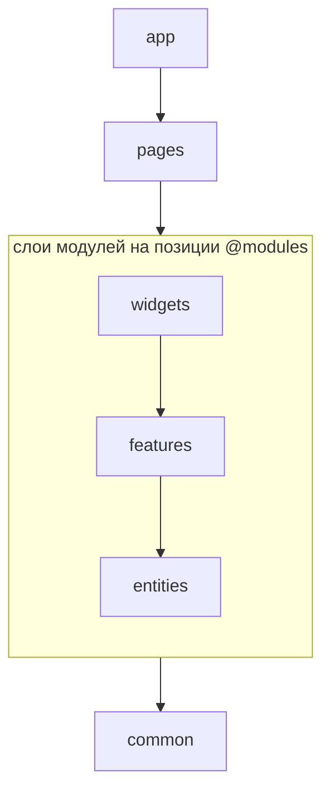

# Схема слоёв

Слои и порядок между ними — часть архитектуры конкретного проекта: состав, количество и границы
слоёв [определяет сам проект](../concepts/layers.md). Общая форма — вертикальная схема: более
стабильные слои находятся ниже, более изменчивые — выше. Направление зависимостей — сверху вниз:
слой может импортировать только то, что стоит [ниже него](../concepts/direction.md).

Схема слоёв — две настройки в [`settings.weld`](../rules/settings.md):

- `layers` — слои проекта;
- `moduleLayers` — слои внутри модуля.

Оба списка записываются снизу вверх: элемент, записанный раньше, находится ниже элемента,
записанного позже.

```js
export default [
    {
        settings: {
            weld: {
                layers: ['common', '@modules', 'pages', 'app'],
                moduleLayers: ['entities', 'features', 'widgets'],
            },
        },
    },
];
```

Что соответствует следующей схеме:

<div align="center">



</div>

Стрелки показывают направление зависимостей, а значит и разрешённый импорт: `app` может
импортировать `pages`, слои модулей и `common`; `pages` — слои модулей и `common`; `common` не может
импортировать никого.

Пример структуры директорий для схемы выше:

```text
src/
├── app/
├── pages/
├── modules/
│   ├── order/
│   │   ├── widgets/
│   │   ├── features/
│   │   └── entities/
│   └── user/
│       ├── widgets/
│       └── entities/
└── common/
```

Каталог `modules/` здесь содержит модули, но сам слоем не является. Имя каталога с модулями можно
[настроить](../rules/settings.md#modulesdir); в этом и дальнейших примерах используется значение по
умолчанию — `modules`.

## `layers` — слои проекта

`layers` — один упорядоченный список на весь проект. Обычные имена в нём — слои проекта: им
соответствуют непосредственные дочерние директории исходного кода.

Имена с префиксом `@` — служебные метки в схеме, а не имена директорий:

- `@modules` — место, куда встают слои модулей из `moduleLayers`;
- `@unknown` — место для кода, [не относящегося ни к одному слою](#unknown-—-код-без-слоя).

## `moduleLayers` — слои модуля

`moduleLayers` задаёт одинаковую для всех модулей последовательность слоёв снизу вверх. В отличие от
слоёв проекта, эти слои существуют не в одном экземпляре, а в каждом модуле — и в каждом вложенном
модуле тоже, на любой глубине.

При импорте не важно, находятся источник и цель в одном модуле или в разных: значение имеет только
положение их слоёв в этом порядке. Поэтому `order/widgets` может импортировать публичную точку входа
`user/features`, а `order/entities` — нет: `features` находится выше `entities`. Остальные границы
модулей, включая публичный API и приватность, продолжают действовать.

`@modules` задаёт уровень этих слоёв в схеме проекта. Поэтому слой модуля видит `common`, но не
видит `pages` и `app` — независимо от того, в каком модуле он находится.

## Почему две настройки, а не один список

Слои можно было бы записать одним списком, перечислив слои модулей прямо на месте маркера.
Разделение сохраняет то, что из одного порядка не выводится: слои проекта существуют в единственном
экземпляре, а слои модуля повторяются в каждом модуле и на любой глубине вложенности. Это разные
сущности, и маркер `@modules` показывает границу между ними одним взглядом.

## Имена слоёв

- **Имя слоя — имя директории.** Обычное имя начинается с буквы и состоит из букв, цифр, `-` и `_`:
  `entities`, `shared-ui`, `app_v2`, `common2`. Имя с `/`, `.` или `..` слоем быть не может: такую
  директорию не с чем было бы сопоставить.
- **`@` зарезервирован под спец-позиции.** Так называются только `@modules` и `@unknown`, и обе
  допустимы только в `layers` — в `moduleLayers` их нет. Других имён, начинающихся с `@`, схема не
  принимает.
- **Одно обычное имя не может стоять в обоих списках.** Слой `app` в `layers` и слой `app` в
  `moduleLayers` — разные слои, но в дереве они неразличимы: директория `app` внутри модуля читалась
  бы то как слой проекта, то как слой модуля.
- **Префикс приватности.** Имя слоя может нести префикс приватности — такой слой закрыт для внешнего
  кода и доступен только внутри директории, в которой лежит. Набор префиксов задаёт проект;
  подробности — в статье [«Приватность»](./privacy.md).

## Повторы: диапазон вместо списка исключений

По умолчанию каждое имя встречается в схеме один раз. Повтор имени ослабляет направление: слой
перестаёт быть точкой и становится диапазоном между первым и последним вхождением. Всё, что попало
внутрь диапазона, становится двунаправленным с этим слоем — вплоть до циклов.

::: info

Повтор — заявление о снятой гарантии, а не «настройка строгости»: пока он в схеме, направление
внутри диапазона не проверяется. Размер послабления виден прямо в списке и сокращается, когда
вхождения сдвигаются навстречу друг другу.

:::

Два вида повторов решают разные задачи: смежный — самое узкое послабление, разнесённый — самое
широкое.

### Смежный повтор

Открывает только горизонтальные связи: одноимённые слои разных модулей могут импортировать друг
друга.

```js
moduleLayers: ['entities', 'entities', 'features', 'widgets'];
```

Здесь `order/entities` и `user/entities` видят друг друга, но права `entities` относительно
остальных не меняются: `features` и `widgets` по-прежнему выше, и получить их `entities` не может.

### Разнесённый повтор

Делает слой двунаправленным со всем, что попало между вхождениями.

```js
layers: ['common', 'legacy', '@modules', 'legacy', 'pages', 'app'];
```

Здесь `legacy` двунаправлен с модулем целиком и его слоями: легаси-код может импортировать их, а они
— легаси. Сам `legacy` до `pages` и `app` при этом не дотягивается — они стоят выше обоих вхождений.

## `@unknown` — код без слоя

Часть кода может остаться без слоя. Для такого кода вне модулей в `layers` есть позиция `@unknown`:

```js
layers: ['common', '@unknown', '@modules', 'pages', 'app'];
```

Позиция задаёт его права, как и у любого другого слоя: код без слоя может импортировать `common`, но
не дотягивается до модулей, `pages` и `app`. В обратную сторону он открыт — импортировать его может
всё, что стоит выше.

Если `@unknown` в схеме нет, такой код — нарушение, а не пропуск: иначе его импорты остались бы
непроверенными при зелёном линте, и непроверенный код выглядел бы ровно как проверенный.
