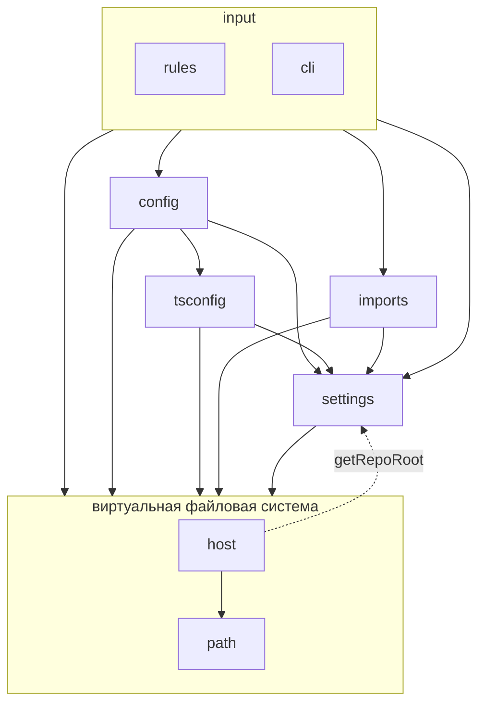

# Зависимости директорий в `src/`

Директория в `src/` — модуль со своим баррелем `index.ts`: снаружи импорт идёт только через
`@/<директория>/index.js`, внутри — прямо в соседний файл. У файлов-модулей (`debug.ts`,
`extensions.ts`, `package.ts`, `bin.ts`) барреля нет.

Схема построена по импортам продакшен-кода; тесты и `*.testing.ts` не учтены, кроме фейка `FsHost`,
который `host/index.ts` намеренно отдает наружу. Стрелка `A --> B` — «`A` импортирует `B`».

Граф ациклический. Направление почти всюду «сверху вниз», единственная зависимость вверх —
`host --> settings` (`getRepoRoot`), и `src/testing/` в продакшен-граф не входит: от него зависят
только тесты.
