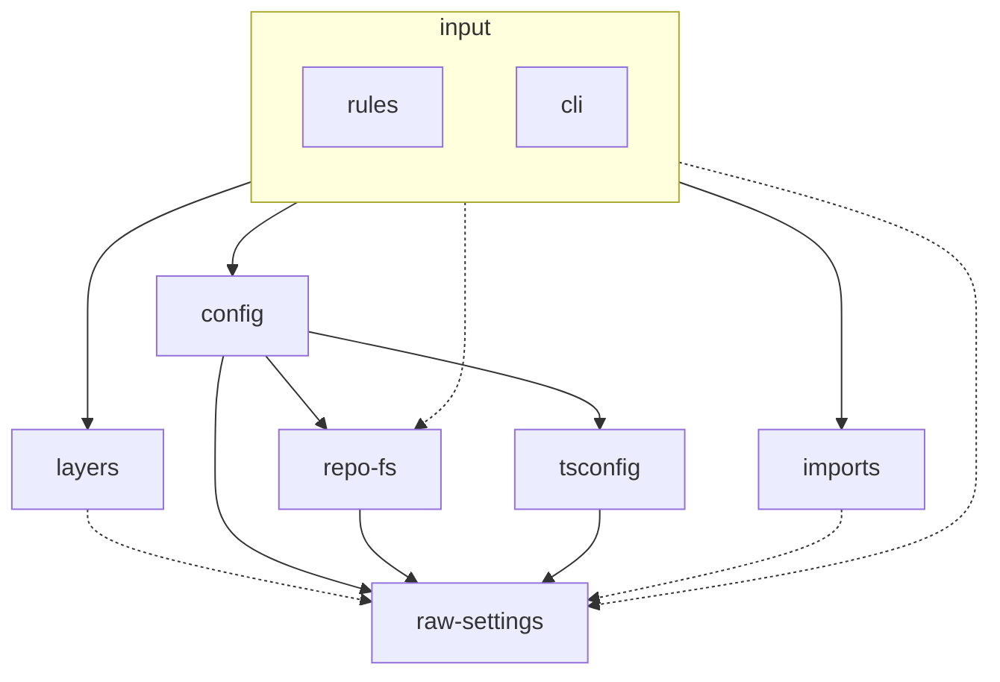

# Зависимости модулей

Схема рисуется вручную, генератора нет. Правила, по которым она строится:

- Вершина — слой `src/<слой>/` или группа `input`: потребители пакета, `src/index.ts` (`rules`) и
  `src/bin.ts` (`cli`). Имена узлов — без префикса `src/`.
- Ребро `A --> B` читается «`A` импортирует `B`»: стрелка смотрит на зависимость. Импорты всех
  файлов слоя схлопываются в одно ребро, импорты внутри одной директории не рисуются.
- Только продакшен-импорты: тесты, `*.testing.ts`, фикстуры и внешние пакеты исключены.
- Сплошное ребро — у зависимости берут поведение (функции, классы). Пунктирное — только типы или
  константы.
- Общий словарь (`src/utils/path/`, `src/extensions.ts`, `src/debug.ts`, `src/package.ts`),
  `src/testing/` и входные файлы не рисуются: это не слои.
- Порядок объявления узлов задает раскладку, иерархия — сверху вниз. Ребро, направленное вверх,
  означает нарушение слоев, а не новую строку схемы.
